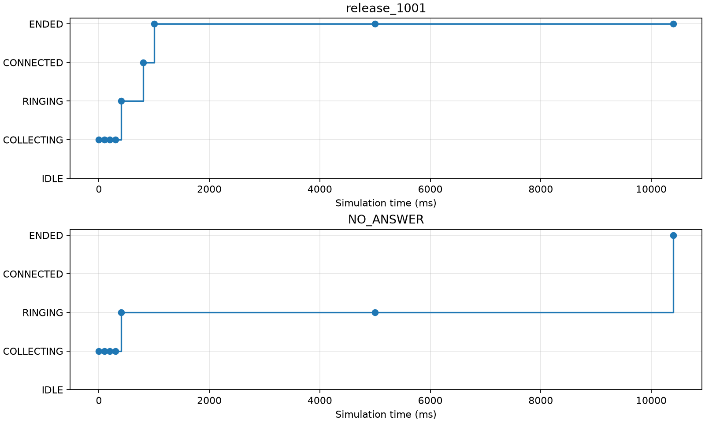

# 实验三 用户事件 号码分析与呼叫控制

姓名：杨欣　学号：2025280305

## 原理与手算

本实验通过事件驱动状态机控制四用户教学交换机。采样值0表示挂机、1表示摘机；只有相邻采样发生变化才产生事件，重复采样不会重复创建呼叫。事件是外部输入，状态是一次呼叫已经推进到的阶段。程序按逻辑时间和入队序号处理事件，控制函数原地更新Call，通过reserve预留被叫，通过activate建立真实双向T/S映射，通过finish统一释放资源。

以1001拨打1002为例：0 ms摘机后进入COLLECTING并启动5000 ms的收号总定时器；100、200、300 ms输入1、0、0均为合法前缀；400 ms输入2形成完整合法号码，预留1002，取消收号定时器，进入RINGING并启动10000 ms振铃定时器。800 ms被叫摘机，激活成功后进入CONNECTED；1000 ms主叫挂机，呼叫以NORMAL_CLEAR结束。此时1002仍摘机，进入WAIT_ONHOOK，必须真实挂机后才能重新使用。

号码长度固定为四位，合法号码来自配置，不能硬编码1001至1004。空串和匹配配置的短前缀返回INCOMPLETE，完整号码返回LOCAL，自身号码返回SELF_CALL；无匹配前缀、非ASCII数字和超过四位返回INVALID。

帧字节公式为(link×101+slot×3+frame_id×17) mod 256。帧0链路0的TS1为3，TS2为6；1001与1002接通后，输出TS1应为6、TS2应为3。双向T映射为目的TS1取源TS2、目的TS2取源TS1，S映射选择链路0。run_frames规定输入帧0的结果在输出帧1可用，即一帧延迟；释放后两个时隙均应输出空闲码0xD5，即十进制213。

无人接听的振铃截止时刻为400+10000=10400 ms。旧收号事件仍在5000 ms出队，但其token已经失效，不能改变RINGING。收号期间每输入一位也不能重置5000 ms截止时刻。

## 结果分析

运行src.run_experiment生成results/call_sequence.png、results/call_events.jsonl及results/scenario_results.json。12个固定场景全部通过，覆盖双向接通、双方分别挂机、号码错误、自呼、被叫忙、收号超时、无人接听、振铃取消、过期定时器、重复采样和释放后复用。时序图如下，日志与判定JSON均由本次代码运行产生。

正常释放场景在400 ms进入RINGING、800 ms进入CONNECTED、1000 ms进入ENDED；5000 ms和10400 ms到来的旧定时器保持ENDED且没有新动作。无人接听场景在5000 ms维持RINGING，到10400 ms以NO_ANSWER结束，输出STOP_RING和FAIL_TONE。状态图的阶梯平台与这些日志时刻一致。

验证不能只看CONNECTED字符串。公开测试和自拟测试直接调用交换网络：帧0输入(3,6)，接通后输出(6,3)，释放后输出(213,213)，且释放后pairs与owners为空。忙线场景中第二次呼叫以USER_BUSY结束，第一次呼叫及其真实话路仍然保留。网络激活失败时结束原因为NETWORK_BUSY，不能将预留成功或回铃音误判为真实接通。

## 反例与验证

student_tests/test_my_case.py包含八个补充测试。第一例在1000、3000、4999 ms仅拨入三个合法前缀数字，预期5000 ms仍以DIAL_TIMEOUT结束，并断言号码为100、owners为空且1001进入等待挂机集合；这能发现每次输入数字重新计时的错误。

第二例在振铃状态注入当前token但错误timer_kind，以及正确类型但错误call_id，断言Call全部字段、归属、等待集合和队列不变，且没有动作。第三例直接给该呼叫输入1003的数字事件，断言不会改变1001的收号。第四例在1002尚未挂机时安排1003呼叫1002，断言忙线且保留1002真实摘机采样。

第五例检查一帧延迟、双向字节互换和释放后的0xD5。第六例先运行至400 ms，使振铃超时已入队，再安排10400 ms应答；超时先处理，C1以NO_ANSWER结束，随后1002摘机创建C2，C2为COLLECTING而非接通旧呼叫。教师同刻顺序测试则事先入队应答，预期应答先处理，两者共同验证先入队先处理规则。

第七例把已接通呼叫的旧定时器全部出队，断言仍CONNECTED、交换输出逐字节不变，两个超时日志动作均为空。第八例检查全角数字被拒绝，以及2001、2002配置下前缀200有效、前缀1无效。全部自拟测试均实际调用任务函数或Exchange并包含行为断言。测试命令与运行输出详见AI_LOG.md及本地验证记录。

## 局限

本实验使用串行逻辑时间和软件注入事件，没有验证真实用户线的电压变化、按键去抖、DTMF检测误差、振铃电路或语音质量。摘挂机检测依赖框架提供的离散采样，号码规则固定为四位，未实现外线、变长号码、计费及更复杂的并发调度。交换函数对字节和映射的验证只能说明教学模型的路由正确，不能据此推断硬件吞吐率和实时延迟。公开测试通过及自动评分只说明当前可执行规则和报告结构满足要求，报告论述质量及最终成绩仍由教师评定。
